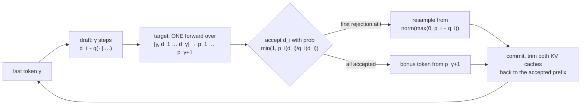
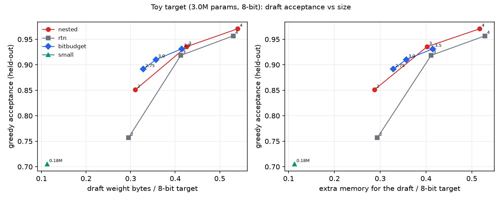
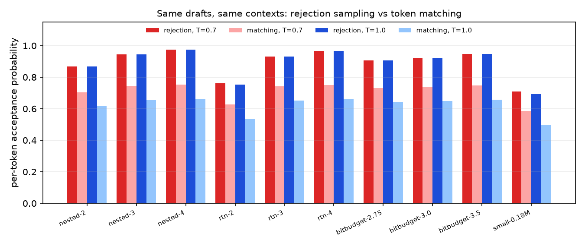
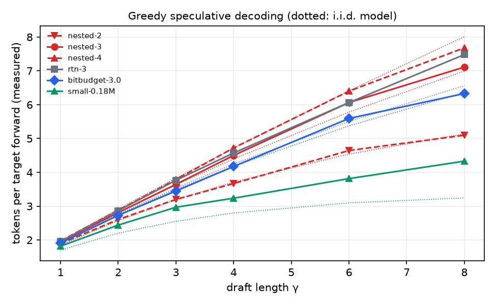

# QuantDraft

**Lossless self-speculative decoding with quantized drafts for on-device LLMs (MLX).**

QuantDraft speeds up a precise model (e.g. an 8-bit LLM) using a *quantized copy of itself* as the draft, so no second model is needed. Output is **guaranteed identical** to the precise model: token for token under greedy decoding, and in distribution under sampling. It implements the speculative decoding algorithm of [Leviathan et al. (ICML 2023)](https://arxiv.org/abs/2211.17192) for mlx-lm models, with three things mlx-lm's built-in `--draft-model` does not have:

1. **The paper's rejection-sampling rule.** mlx-lm verifies drafts by sampling the target independently and checking whether the two tokens match. That is lossless too, but at temperature > 0 it accepts with probability `Σ p·q` instead of `Σ min(p, q)`. In the toy run below, the paper's rule produces **56–72% more tokens per target forward pass at T = 0.7** with the same draft.
2. **Drafts derived from the target.** These include nested bit-plane drafts (the top k bits of the target's own 8-bit integers, built in seconds with no calibration), round-to-nearest drafts, and [BitBudget](https://github.com/JayaChandraDadi/BitBudget) mixed-precision drafts.
3. **A cost-model controller** that picks the draft length γ every round. It maximizes expected speedup from the online acceptance estimate and measured forward costs, and falls back to plain decoding when drafting stops paying for itself.

```bash
mlx_lm.convert --hf-path Qwen/Qwen2.5-1.5B-Instruct -q --q-bits 8 --mlx-path qwen-8bit
quantdraft generate --target qwen-8bit --draft nested:3 --gamma auto \
    --prompt "Write a Python function that checks whether a string is a palindrome."
```

---

## Why

Decoding one token streams every weight from memory, so on a phone or laptop generation speed is set by memory bandwidth, not compute. Checking several tokens in one forward pass costs about the same as generating one, because the weights are read once for all of them.

Speculative decoding exploits that: a cheap draft guesses γ tokens, the target checks them all at once, and a rejection rule keeps the longest acceptable prefix.

The usual catch is that you need a good draft model that shares the target's tokenizer, which often doesn't exist for a given on-device model. A heavily quantized copy of the target always exists, agrees with it unusually well, and reads a fraction of the bytes per token.

## How it works



**Losslessness.** For any draft distribution `q`, emitting `d ~ q` with probability `min(1, p(d)/q(d))` and otherwise sampling from `norm(max(0, p − q))` produces exactly `p`. The per-token acceptance probability is `Σ min(p, q) = 1 − TV(p, q)`. At temperature 0 this reduces to "accept while the draft's token equals the target's argmax".

**KV-cache bookkeeping** is where implementations usually go wrong. The invariant is that each cache holds every committed token except a short *pending* list. The target's pending list is always just the last token. The draft's is the last token, or `[d_γ, y]` after a fully accepted round, because the draft sampled `d_γ` but never consumed it. After each round, both caches are trimmed to the accepted prefix (`quantdraft/engine.py`). A 200-token greedy run with hundreds of accept, reject, and rollback cycles must reproduce the target exactly, and that is a test.

**Nested bit-plane drafts.** For an affine-quantized `B`-bit target layer (`w = s·q + b`), the `k`-bit draft keeps the top bits of the same integers:

```
q_k = q_B >> (B − k),    s_k = s · 2^(B−k),    b_k = b + s · (2^(B−k) − 1) / 2
```

The half-step offset re-centres each coarse bin. No calibration is needed, the draft is built in seconds, and every draft weight is a truncation of a number the target already stores. With a bit-plane memory layout the draft would therefore cost **no extra memory**. MLX's kernels expect contiguous k-bit packing, so this version re-packs into a small separate array; a fused bit-plane Metal kernel is the natural follow-up. Embeddings and norms are shared by reference.

**Choosing γ.** With acceptance probability α, a round yields `E[tokens] = (1 − α^(γ+1)) / (1 − α)` tokens and costs `γ·t_draft + t_target(γ+1)`. `CostModelGamma` tracks α with an EMA of the per-position `Σ min(p, q)`, learns `t_draft` and `t_target(k)` from the engine's own timings (or uses a profile from `quantdraft profile`), and picks the γ that maximizes `E[tokens] · t_target(1) / cost`. That includes γ = 0, meaning "don't speculate".

## How it differs from mlx-lm's speculative decoding

| | `mlx_lm.generate --draft-model` | QuantDraft |
|---|---|---|
| verification at T > 0 | sample target, accept if tokens match (`Σ p·q`) | rejection sampling (`Σ min(p, q)`) |
| draft length | fixed `--num-draft-tokens` | fixed, heuristic, or cost-model adaptive (can turn itself off) |
| draft model | a separate model you must provide | nested bit-plane / RTN / BitBudget copies of the target, or any model |
| analysis tooling | – | teacher-forced acceptance profiling, forward-cost profiling, speedup model, plots |

## Results

### Toy-scale validation (measured here, hardware-independent)

The target is the 3.0M-parameter byte-level Llama from BitBudget's toy run, **quantized to 8 bits**. Acceptance is measured teacher-forced on 12k held-out positions, scoring the target and each draft on identical contexts, so there is no sampling noise. "Projected" speedups use the measured acceptance plus each draft's weight bytes under a memory-bound model (`t ∝ bytes`, verification cost equal to a 1-token forward). They are **projections, not measurements**; wall-clock speedups need Apple silicon (`scripts/run_sweep.sh`).

| draft | weight bytes vs target | greedy acceptance | α rejection @T=0.7 | α matching @T=0.7 | projected speedup (best γ) |
|---|---|---|---|---|---|
| nested 2-bit | 0.31× | 0.851 | 0.869 | 0.705 | 1.66× (γ=4) |
| nested 3-bit | 0.43× | 0.935 | 0.946 | 0.745 | 1.63× (γ=5) |
| nested 4-bit | 0.54× | **0.971** | 0.976 | 0.753 | 1.51× (γ=6) |
| RTN 2-bit | 0.30× | 0.757 | 0.762 | 0.626 | 1.47× (γ=3) |
| RTN 3-bit | 0.41× | 0.918 | 0.932 | 0.742 | 1.60× (γ=4) |
| RTN 4-bit | 0.53× | 0.957 | 0.967 | 0.751 | 1.48× (γ=5) |
| BitBudget 2.75 bpw | 0.33× | 0.891 | 0.906 | 0.730 | **1.74×** (γ=4) |
| BitBudget 3.0 bpw | 0.36× | 0.910 | 0.922 | 0.738 | 1.72× (γ=5) |
| BitBudget 3.5 bpw | 0.42× | 0.931 | 0.946 | 0.747 | 1.65× (γ=5) |
| separate small model (0.18M params) | 0.11× | 0.705 | 0.708 | 0.585 | 1.93× (γ=4) |

<p align="center">
<br>


</p>

What this shows:

* **Lossless in practice.** All 36 greedy configurations (6 drafts × 6 values of γ, 6 prompts each) reproduced the 8-bit target's output token for token.
* **Nested drafts beat RTN at the same bit-width** (2-bit: 0.851 vs 0.757 greedy acceptance), with no calibration. Truncating the target's *own* integers keeps the draft close to the target it must agree with, rather than to the original float weights.
* **BitBudget drafts are the best quantized drafts per byte.** At 0.33× the target's bytes, BitBudget 2.75 bpw accepts 89% of greedy tokens, and it has the best projected speedup among self-drafts. The two projects compose: BitBudget's allocator decides where a draft can afford to be coarse.
* **The verification rule matters as much as the draft.** At T = 0.7 the paper's rule accepts 71–98% of draft tokens (per-token probability) where token matching accepts 59–75%. In real sampled runs that is 4.30 vs 2.76 tokens per target forward for the nested 3-bit draft (+56%), and 4.24 vs 2.47 for RTN 3-bit (+72%).
* **The i.i.d. acceptance model predicts measured tokens per forward well** (dotted lines in the third figure), which is what makes the cost-model controller workable.
* **A tiny separate draft still projects fastest at this scale**, because it is 9× smaller than the target. Self-drafts win on acceptance and need no second model. Whether they win on wall-clock time with real model families (for example 0.5B drafting for 1.5B, where the size ratio is ~0.33×, not 0.11×) is exactly what the Apple-silicon sweep measures. Note also that the engine runs above use only 6 prompts; the teacher-forced numbers over 12k positions are the reliable comparison.

### Real models on Apple silicon

`scripts/run_sweep.sh` uses Qwen2.5-1.5B-Instruct at 8 bits as the target. Drafts are nested 2/3/4-bit, RTN 3/4-bit, BitBudget 2.75/3.0/3.5 bpw, and Qwen2.5-0.5B-Instruct 4-bit as the classic separate draft. It runs γ ∈ {1, 2, 3, 4, 6, 8, heuristic, auto}, T ∈ {0, 0.7}, and both verification rules, and measures decode tok/s, speedup, acceptance, and tokens per forward. It also profiles `t_target(k)` and `t_draft` and overlays the predicted speedups. **It has not been run for this release**, because the build machine had no Apple GPU and no Hugging Face access, so the table is deliberately empty.

| draft | extra memory | α (greedy) | best fixed γ | decode tok/s | speedup | auto-γ speedup |
|---|---|---|---|---|---|---|
| nested 3-bit | – | – | – | – | – | – |
| BitBudget 3.0 bpw | – | – | – | – | – | – |
| RTN 3-bit | – | – | – | – | – | – |
| Qwen2.5-0.5B 4-bit | – | – | – | – | – | – |

## Quickstart

```bash
git clone https://github.com/JayaChandraDadi/QuantDraft && cd QuantDraft
python -m venv .venv && source .venv/bin/activate
pip install -e ".[dev,bitbudget]"

# full experiment (Apple silicon)
./scripts/run_sweep.sh

# or piece by piece
mlx_lm.convert --hf-path Qwen/Qwen2.5-1.5B-Instruct -q --q-bits 8 --mlx-path qwen-8bit
quantdraft profile  --target qwen-8bit --draft nested:3 --json cost.json
quantdraft bench    --target qwen-8bit --draft nested:3 rtn:3 path/to/bitbudget-draft \
                    --gammas 1,2,4,6,auto --temps 0,0.7 --results results.jsonl
quantdraft plot     --results results.jsonl --out figures
```

`--draft` accepts `nested:K` (top K bit-planes of a quantized target), `rtn:K`, or any mlx-lm model path or Hugging Face repo with the same tokenizer. `--gamma` takes an integer, `heuristic`, or `auto`. `--verify rejection|match` selects the verification rule.

Python API:

```python
from mlx_lm import load
from quantdraft import nested_draft, speculative_generate, CostModelGamma

target, tok = load("qwen-8bit")
draft = nested_draft(target, bits=3)
tokens, stats = speculative_generate(target, draft, tok.encode("Hello"), max_tokens=128,
                                     gamma=CostModelGamma(), temperature=0.7)
print(tok.decode(tokens), stats.summary())
```

## Tests

```bash
pytest -q   # 67 tests, CPU-only, no downloads (~70 s)
```

* **Greedy losslessness:** identical output to the target across drafts (good, bad, perfect), γ ∈ {0, 1, 2, 5, 9}, all three controllers, a single-token prompt, EOS, and a 200-token run that exercises hundreds of cache rollbacks.
* **Distributional losslessness:** an exact enumeration proof of the rejection rule, a Monte-Carlo χ² test of `verify_rejection`, and an end-to-end χ² test that the engine's first two sampled tokens follow the target's exact joint distribution, for **both** verification rules.
* **Rejection ≥ matching** acceptance on identical contexts at every temperature; a perfect draft is always accepted under rejection sampling but not under matching.
* **Bit-plane drafts:** our packing matches MLX's for 2–8 bits, truncation is exact bit-plane arithmetic, its error stays comparable to RTN, and drafts never mutate the target.
* **Cost model and controllers:** expected tokens matches simulation, maximum-likelihood α recovery, the heuristic schedule, the cost-model controller turning speculation off, scaling γ with α, and learning costs online.
* **CLI end to end** (`generate`, `profile`, `bench`, `plot`) on a tiny local model.

CI runs the suite on GitHub's Apple silicon runner.

## Repository layout

```
quantdraft/
  engine.py       speculative_generate / autoregressive_generate, verification rules, KV rollback
  drafts.py       nested bit-plane drafts, RTN drafts, MLX bit packing, byte accounting
  controllers.py  fixed / heuristic / cost-model gamma
  costmodel.py    expected tokens, speedup model, CostModel, alpha fitting
  analysis.py     teacher-forced acceptance profiling
  bench.py        forward-cost profiling, benchmark runners
  prompts.py      mixed benchmark prompts (code, structured, explanatory, open-ended)
  plotting.py     figures from results JSONL
  cli.py          `quantdraft generate | profile | bench | plot`
scripts/run_sweep.sh     Apple-silicon experiment
examples/toy_validation.py
tests/
```

## Limitations and next steps

* **Batch size 1.** This is the on-device setting. Batched verification needs per-sequence cache trimming.
* **Nested drafts re-pack their bits** into a separate array. A bit-plane-major weight layout plus a Metal kernel that reads only the top k planes would make the draft truly free in memory. This is the most interesting follow-up for phones.
* **Temperature-only sampling.** Top-p and top-k change both `p` and `q` and must be applied consistently before the rejection test.
* **KV cache.** Draft and target keep separate caches. Sharing a quantized KV cache between them (as in QuantSpec) would cut memory further.
* **Projections assume memory-bound decoding.** `quantdraft profile` measures the real `t_target(k)` curve, and the sweep checks predicted against measured speedups.

## References

* Leviathan, Kalman, Matias. *Fast Inference from Transformers via Speculative Decoding.* ICML 2023.
* Chen et al. *Accelerating Large Language Model Decoding with Speculative Sampling.* 2023.
* Apple's *Recurrent Drafter* (ReDrafter) for speculative decoding, 2024.
* *QuantSpec: Self-Speculative Decoding with Hierarchical Quantized KV Cache*, 2025, and *Matryoshka Quantization*, 2025, which explore related ideas (quantized self-drafts and nested integer bit-slicing).
* [MLX](https://github.com/ml-explore/mlx) / [mlx-lm](https://github.com/ml-explore/mlx-lm); [BitBudget](https://github.com/JayaChandraDadi/BitBudget) for mixed-precision drafts.

MIT License.
